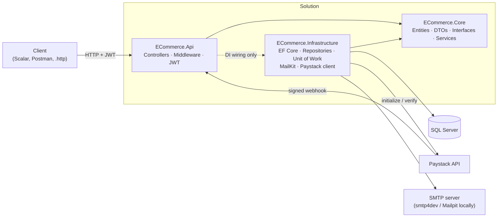

# E-Commerce Web API


A backend REST API for a single online store, built with ASP.NET Core and SQL Server. Customers register, browse a
catalogue with search, filters and pagination, manage a cart, check out, and pay through **Paystack**. Stock is
reserved safely at checkout, so two shoppers can never buy the same last item. Admins manage products and categories,
move orders through a fixed status flow, view customers and see a sales dashboard. Customers get emails over SMTP when
they sign up, place an order, pay, and when their order status changes. There is no frontend: you try it through
**Scalar** (interactive API docs), the included **Postman** collection or the `ECommerce.http` file.

---

## Tech stack

| Area | Choice |
|---|---|
| Framework | .NET 10, ASP.NET Core Web API (controllers) |
| Data | EF Core 10 (code-first migrations, Fluent API), SQL Server |
| Auth | JWT bearer tokens, role-based authorization (`Customer`, `Admin`), BCrypt password hashing |
| Payments | Paystack (Initialize + Verify Transaction, HMAC-SHA512 signed webhook), typed `HttpClient` |
| Email | MailKit over SMTP; smtp4dev or Mailpit as a fake inbox locally |
| Caching | `IMemoryCache` |
| API docs | OpenAPI + Scalar UI at `/scalar` |

## Architecture

Three projects with one dependency rule: **Core depends on nothing**. Api and Infrastructure both point inward to it.



- **ECommerce.Core** holds the business logic (services) and the interfaces it needs: `IUnitOfWork`, `IEmailService`,
  `IPaystackClient`. It has no EF Core or ASP.NET reference, so the rules don't depend on the database or the web framework.
- **ECommerce.Infrastructure** implements those interfaces: `AppDbContext`, repositories, `UnitOfWork`, `SmtpEmailService`, `PaystackClient`.
- **ECommerce.Api** is thin. Each controller action calls one service method and wraps the result in the standard
  response. `Program.cs` connects interfaces to implementations through dependency injection.

## Features

**Customers**
- Register and log in (JWT). Everyone who registers is a `Customer`; the role can't be chosen.
- View and update their profile.
- Browse categories and products: search, filter by category and price range, sort, paginate.
- Cart: add, change quantity, remove, empty. Shows current prices and flags items that are no longer available.
- Checkout in one database transaction, with stock reserved by a conditional update (no overselling).
- Order history and order details. Cancel a pending order, which returns its stock.
- Pay with Paystack. The order becomes `Paid` through a signed webhook or a verify call.
- Emails: welcome, order placed, payment received, order status changed.

**Admins** (seeded at startup, can't register)
- Products: list (including inactive), create, update, soft-delete.
- Categories: create, rename, delete (blocked while it still has products).
- Orders: list by status, view any order, move it through the status flow
  (`Pending → Cancelled`, `Paid → Processing → Shipped → Delivered`). Any other change is rejected with 409.
- Customers: read-only list with order counts (password hashes are never even read).
- Dashboard: order counts by status, revenue from paid orders, low-stock products, latest orders.

---

## Running it locally

### 1. Prerequisites

- [.NET 10 SDK](https://dotnet.microsoft.com/download)
- SQL Server, any of these:
  - **LocalDB** (installed with Visual Studio's "ASP.NET and web development" workload), or
  - **SQL Server Express** (free), or
  - **Docker**: `docker compose up -d` starts SQL Server and Mailpit (copy `.env.example` to `.env` and set a strong SA password first)
- EF Core CLI: `dotnet tool install --global dotnet-ef`
- A fake SMTP inbox: **smtp4dev** (`dotnet tool install --global Rnwood.Smtp4dev`, no Docker needed) or Mailpit (in `docker-compose.yml`)
- A free [Paystack](https://paystack.com) account in **test mode**, for the `sk_test_...` secret key
- Optional: [Postman](https://www.postman.com/downloads/)

### 2. Clone

```bash
git clone <this-repo-url>
cd ecommerce-api
```

### 3. Set the secrets

No secrets are stored in the repo. They live in [user-secrets](https://learn.microsoft.com/aspnet/core/security/app-secrets),
outside the project folder. The app checks them at startup and refuses to start, with a clear message, if one is missing.

```bash
# Database: pick the line that matches your SQL Server
dotnet user-secrets set "ConnectionStrings:DefaultConnection" "Server=(localdb)\MSSQLLocalDB;Database=ECommerceDb;Trusted_Connection=True;TrustServerCertificate=True" --project src/ECommerce.Api
# dotnet user-secrets set "ConnectionStrings:DefaultConnection" "Server=localhost\SQLEXPRESS;Database=ECommerceDb;Trusted_Connection=True;TrustServerCertificate=True" --project src/ECommerce.Api
# dotnet user-secrets set "ConnectionStrings:DefaultConnection" "Server=localhost,1433;Database=ECommerceDb;User Id=sa;Password=<your-sa-password>;TrustServerCertificate=True" --project src/ECommerce.Api

# JWT signing key: any random string of at least 32 characters
dotnet user-secrets set "Jwt:Key" "<random-string-at-least-32-characters>" --project src/ECommerce.Api

# Paystack TEST secret key (Paystack dashboard → Settings → API Keys & Webhooks)
dotnet user-secrets set "Paystack:SecretKey" "sk_test_<your-test-key>" --project src/ECommerce.Api

# Passwords for the seeded accounts (admin@ecommerce.local and customer@ecommerce.local), at least 8 characters
dotnet user-secrets set "Seed:AdminPassword" "<admin-password>" --project src/ECommerce.Api
dotnet user-secrets set "Seed:CustomerPassword" "<customer-password>" --project src/ECommerce.Api

# Optional: where Paystack sends the customer after paying
# dotnet user-secrets set "Paystack:CallbackUrl" "http://localhost:5152/payment-complete" --project src/ECommerce.Api
```

Non-secret settings (JWT issuer and expiry, SMTP host and port, sender address, seeded emails) are in
`src/ECommerce.Api/appsettings.json` and `appsettings.Development.json`.

### 4. Create the database

```bash
dotnet ef database update -p src/ECommerce.Infrastructure -s src/ECommerce.Api
```

On the first run the app seeds 1 admin, 1 test customer (Development only), 4 categories and about 20 products.
Seeding only runs when the database is empty.

### 5. Start a fake inbox

The app sends to `localhost:2525` in Development. Use either:

```bash
smtp4dev --smtpport=2525        # inbox UI: the URL printed in the console (http://localhost:5000 by default)
# or
docker compose up -d mailpit    # inbox UI: http://localhost:8025
```

If no inbox is running, the API still works. Failed emails are logged, never thrown.

### 6. Run the API

```bash
dotnet run --project src/ECommerce.Api
```

Open **http://localhost:5152/scalar** for the interactive docs. Log in with `POST /api/auth/login`, then paste the
token into Scalar's Bearer box.

### 7. Try it with Postman (or `ECommerce.http`)

1. In Postman: **Import** → select both files in `postman/` (`ECommerce.postman_collection.json` and `ECommerce.local.postman_environment.json`).
2. Select the **ECommerce Local** environment.
3. Set `adminPassword` (your `Seed:AdminPassword`) and `paystackSecretKey` (your `sk_test_` key) in the **Current value**
   column only. That column stays on your machine; the shared values in the repo are deliberately empty.
4. Run the folders top to bottom: Auth → Catalogue → Cart → Orders → Payments → Admin. Login requests save the token for you.

`ECommerce.http` has the same flow for Visual Studio, Rider or VS Code (REST Client).

### 8. Pay with Paystack test mode

1. Place an order, then call `POST /api/payments/initialize/{orderId}`. The response contains an `authorizationUrl`.
2. Open it in a browser and pay with one of [Paystack's test cards](https://paystack.com/docs/payments/test-payments/). No real money moves.
3. Call `GET /api/payments/verify/{reference}`. The payment becomes `Successful` and the order `Paid`, and a "payment received" email arrives.

Locally, Paystack can't reach your machine to call the webhook. The Postman collection includes a **signed webhook**
request whose pre-request script computes the `x-paystack-signature` header with your test key, plus a
wrong-signature request that must return 401. In production you'd set the webhook URL in the Paystack dashboard.

---

## Endpoints

All responses use one format. Success: `{ "success": true, "data": ..., "meta"?: {...} }`.
Error: `{ "success": false, "error": { "code": "...", "message": "..." } }`.

| Method | Route | Auth |
|---|---|---|
| POST | `/api/auth/register` | Public |
| POST | `/api/auth/login` | Public |
| GET | `/api/auth/me` | Customer or Admin |
| PUT | `/api/auth/me` | Customer or Admin |
| GET | `/api/categories` | Public |
| GET | `/api/products?page&pageSize&search&categoryId&minPrice&maxPrice&sortBy` | Public |
| GET | `/api/products/{id}` | Public |
| GET | `/api/cart` | Customer |
| POST | `/api/cart/items` | Customer |
| PUT | `/api/cart/items/{itemId}` | Customer |
| DELETE | `/api/cart/items/{itemId}` | Customer |
| DELETE | `/api/cart` | Customer |
| POST | `/api/orders` | Customer |
| GET | `/api/orders?page&pageSize` | Customer |
| GET | `/api/orders/{id}` | Customer |
| POST | `/api/orders/{id}/cancel` | Customer |
| POST | `/api/payments/initialize/{orderId}` | Customer |
| GET | `/api/payments/verify/{reference}` | Customer |
| POST | `/api/payments/webhook` | Public (Paystack signature required) |
| GET | `/api/admin/products?page&pageSize&search&categoryId&isActive` | Admin |
| GET | `/api/admin/products/{id}` | Admin |
| POST | `/api/admin/products` | Admin |
| PUT | `/api/admin/products/{id}` | Admin |
| DELETE | `/api/admin/products/{id}` (soft delete) | Admin |
| POST | `/api/admin/categories` | Admin |
| PUT | `/api/admin/categories/{id}` | Admin |
| DELETE | `/api/admin/categories/{id}` | Admin |
| GET | `/api/admin/orders?status&page&pageSize` | Admin |
| GET | `/api/admin/orders/{id}` | Admin |
| PUT | `/api/admin/orders/{id}/status` | Admin |
| GET | `/api/admin/customers?page&pageSize&search` | Admin |
| GET | `/api/admin/dashboard` | Admin |

---

## Design decisions

Short versions below. [`docs/DESIGN.md`](docs/DESIGN.md) covers each one in more depth: the problem, what I did, why, and the trade-off.

- **Unit of Work + repositories.** Services talk to `IUnitOfWork`, which exposes the repositories, one
  `SaveChangesAsync` and transaction control. *"Isn't DbContext already a Unit of Work?"* Yes. The wrapper exists to keep
  Core free of EF Core, to group every repository behind one commit, and to give one place to start, commit and roll
  back transactions. The cost is an extra layer, and a query method to write for each new data need.
- **`decimal` for money.** Prices and totals are `decimal` in C# and `decimal(18,2)` in SQL Server, because `double`
  can't store 0.10 exactly and rounding errors add up in totals. Amounts are only converted to kobo (`× 100`, `long`)
  inside `PaystackClient`.
- **No overselling.** Checkout runs in one transaction. Stock is taken with a conditional
  `UPDATE Products SET StockQuantity = StockQuantity - @qty WHERE Id = @id AND StockQuantity >= @qty`. If 0 rows change,
  the whole checkout rolls back with a 409. Checking and changing stock in one statement means two buyers can't both pass
  a "check stock" step and both take the last item. Rows are updated in product-ID order, so two checkouts can't deadlock.
- **`AsNoTracking` vs tracking.** Reads use `AsNoTracking()` and `Select` straight into DTOs, so EF does no
  change-tracking work and SQL fetches only the needed columns. Writes load tracked entities, so `SaveChanges` knows what changed.
- **Eager loading vs projection; lazy loading off.** When a write needs related data (the cart with its items and
  products at checkout), it uses `Include`/`ThenInclude`, which loads everything in one query. Reads use `Select`
  projections instead, which join only what the DTO needs. Lazy loading is off, so a loop can never quietly run one
  query per row (the N+1 problem).
- **Caching with `IMemoryCache`.** The category list (30 min) and single products (10 min) are cached. Admin changes, and
  stock changes from checkout or cancel, remove the affected entries. Product lists (too many filter combinations), carts,
  orders and payments (per user, and they must be exact) are not cached. Cart and checkout always check stock in the database, never the cache.
- **Middleware order and one error format.** Request logging comes first, then the exception handler, then status-code
  pages, authentication and authorization. Services throw typed exceptions (`NotFoundException` → 404,
  `ConflictException` → 409, and so on), and the middleware turns them into the standard error JSON. Unexpected errors
  return a generic 500 and are logged in full. Validation errors and empty 401/403/404 responses use the same format.
- **JWT + role-based auth (401 vs 403).** Login returns a JWT with `sub`, `email` and `role` claims. Controllers use
  `[Authorize(Roles = "Customer")]` or `"Admin"`. No token, or an invalid one, gives **401** (we don't know who you are).
  A valid customer token on an admin route gives **403** (we know who you are, and the answer is no). Another user's
  order gives **404**, so the API doesn't reveal that the order exists. The user ID always comes from the token, never from the URL or body.
- **Paystack webhook + verify.** The webhook is anonymous, so the `x-paystack-signature` header (HMAC-SHA512 of the raw
  body, compared in constant time) is checked before the body is parsed. Even then, the body isn't trusted: the API calls
  Paystack's *Verify Transaction* and checks the amount and currency. The status changes are conditional, so a repeated
  webhook, or a webhook and the verify endpoint running together, mark the order paid only once.
- **Emails after the commit.** An email can't be rolled back. It goes out only after the transaction commits, inside a
  try/catch. A mail-server failure is logged and never breaks an order or a payment.

## What I'd add next

- **Refresh tokens.** Short-lived access tokens plus revocable refresh tokens, so logout and "sign out everywhere" really work server-side.
- **A background job to expire unpaid orders.** Right now a `Pending` order holds its stock until it's cancelled. A
  scheduled job would cancel orders left unpaid for 30 minutes and return their stock.
- **Automated tests.** Unit tests for the services (status flow, payment confirmation), and integration tests against a
  real SQL Server for the concurrency paths (two buyers, one item).
- **Redis.** A shared cache when running more than one instance, since `IMemoryCache` is per process.
- **Docker image + CI.** A Dockerfile for the API, and a GitHub Actions pipeline that builds, runs the tests and the
  Postman collection on every pull request.
- **An outbox for emails.** Store emails in the same transaction and send them from a background worker, so a crash
  between commit and send can't lose one.

## Screenshots

| Scalar API docs | Postman collection |
|---|---|
|  |  |

| Order emails in the fake inbox | Paystack test checkout |
|---|---|
|  |  |

## Project structure

```
src/
├── ECommerce.Api/            Controllers (public + Admin/), Middleware, Program.cs, appsettings (no secrets)
├── ECommerce.Core/           Entities, Enums, DTOs, Interfaces, Services, Exceptions, Settings
└── ECommerce.Infrastructure/ AppDbContext, Configurations, Migrations, Repositories, UnitOfWork,
                              Email (MailKit), Payments (Paystack), Seeding
postman/                      Collection + local environment (secrets left empty)
docs/DESIGN.md                Design decisions in depth
ECommerce.http                Every request, in order
docker-compose.yml            SQL Server + Mailpit (optional)
```
